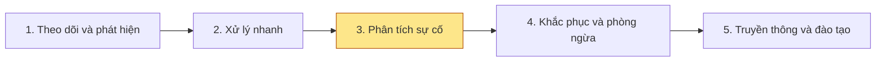
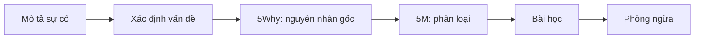

# Làm sao phân tích sự cố hiệu quả?

Phân tích sự cố giúp bạn hiểu **điều gì đã xảy ra**, xác định **vấn đề**, chỉ ra **nguyên nhân gốc rễ**, rồi rút ra **bài học** và **biện pháp phòng ngừa** để sự cố không lặp lại.

Bộ tài liệu này dành cho đội phát triển, vận hành và chất lượng phần mềm. Mỗi bước đều có câu hỏi dẫn dắt, bảng biểu mẫu và ví dụ để áp dụng ngay.


Các số liệu, tên người, ngày tháng trong ví dụ đều là **giả định** để minh họa.


## Phân tích sự cố nằm ở đâu trong quy trình quản lý sự cố?

## Quy trình phân tích 6 bước

## Bắt đầu từ đâu?

<table data-view="cards">
  <thead>
    <tr>
      <th></th>
      <th></th>
      <th data-hidden data-card-target data-type="content-ref"></th>
    </tr>
  </thead>
  <tbody>
    <tr>
      <td><strong>Đang viết hồ sơ</strong></td>
      <td>Đi theo quy trình 6 bước, bắt đầu từ mô tả sự cố.</td>
      <td><a href="quy-trinh/mo-ta-su-co.md">mo-ta-su-co.md</a></td>
    </tr>
    <tr>
      <td><strong>Muốn xem mẫu</strong></td>
      <td>Một hồ sơ hoàn chỉnh từ mô tả đến phòng ngừa.</td>
      <td><a href="phu-luc/vi-du-hoan-chinh.md">vi-du-hoan-chinh.md</a></td>
    </tr>
    <tr>
      <td><strong>Cần khung điền sẵn</strong></td>
      <td>Template sao chép và điền.</td>
      <td><a href="phu-luc/mau-ho-so.md">mau-ho-so.md</a></td>
    </tr>
    <tr>
      <td><strong>Rà soát hồ sơ</strong></td>
      <td>Checklist tự đánh giá chất lượng.</td>
      <td><a href="phu-luc/checklist.md">checklist.md</a></td>
    </tr>
  </tbody>
</table>
