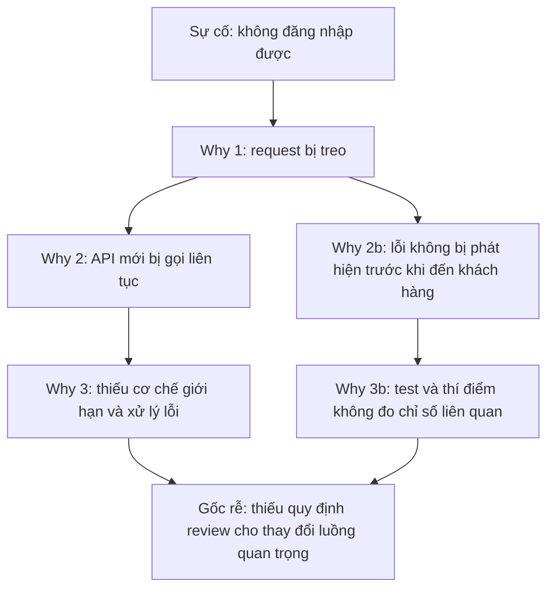

# Bước 3: Tìm nguyên nhân gốc rễ với 5Why

## 5Why là gì?

5Why là kỹ thuật **hỏi "Tại sao?" liên tiếp (thường khoảng 5 lần)** để đi từ biểu hiện bề mặt xuống **nguyên nhân gốc rễ**. Mỗi câu trả lời trở thành đầu vào cho câu hỏi tiếp theo, cho đến khi tới một nguyên nhân mà nếu khắc phục thì sự cố không lặp lại.

Con số 5 chỉ là gợi ý. Có thể dừng ở 3 hoặc phải hỏi tới 7, miễn là đã chạm tới nguyên nhân **có thể hành động được**.

## Ví dụ minh họa

Sự cố giả định: khách hàng không đăng nhập được web app sau một đợt release.

| Bước | Câu hỏi | Trả lời |
|---|---|---|
| Sự cố | | Khách hàng không đăng nhập được |
| Why 1 | Tại sao không đăng nhập được? | Request bị treo ở web app |
| Why 2 | Tại sao request bị treo? | Một API mới bị gọi liên tục |
| Why 3 | Tại sao API bị gọi liên tục? | Logic gọi API chưa có cơ chế giới hạn và xử lý lỗi |
| Why 4 | Tại sao không phát hiện khi kiểm thử và thí điểm? | Kịch bản test không bao phủ trường hợp này, thí điểm không đo chỉ số liên quan |
| Why 5 | Tại sao kịch bản test thiếu? | Quy trình chưa yêu cầu đánh giá tác động khi thêm API vào luồng đăng nhập |

**Nguyên nhân gốc rễ:** thiếu quy định review và kiểm thử cho thay đổi trên luồng quan trọng. Đây là yếu tố phương pháp, cải tiến được, khác với việc dừng ở "dev viết code sai".

## Cách áp dụng hiệu quả



## Bắt đầu từ mô tả chính xác

Câu hỏi đầu tiên phải dựa trên sự thật có số liệu từ [Bước 1](mo-ta-su-co.md), không dựa trên phỏng đoán.



## Mỗi câu trả lời phải có bằng chứng

Kiểm chứng bằng log, metric, code, commit. Dùng số liệu để loại trừ giả thuyết sai, ví dụ CPU và RAM thực tế cho thấy không thiếu tài nguyên.



## Hỏi về hệ thống, không hỏi về cá nhân

Thay "Tại sao A làm sai?" bằng "Tại sao quy trình cho phép sai sót này lọt qua?". Cách này tránh đổ lỗi và dẫn tới nguyên nhân sửa được.



## Chạy nhiều chuỗi

Chạy ít nhất hai chuỗi: tại sao lỗi **xảy ra** và tại sao lỗi **không bị phát hiện** trước khi đến khách hàng. Thêm chuỗi thứ ba nếu khắc phục lâu: tại sao **xử lý chậm**.



## Rẽ nhánh khi có nhiều nguyên nhân

Một "why" có thể có nhiều câu trả lời. Hãy vẽ thành cây thay vì ép thành một đường thẳng.



## Làm theo nhóm

Mời người trực tiếp làm (dev, QA, vận hành) cùng phân tích để tránh bỏ sót góc nhìn. Một giờ họp với bảng trắng thường hiệu quả hơn một người ngồi viết một mình.



## Biết khi nào dừng

Dừng khi nguyên nhân thuộc về **con người** (năng lực, tuân thủ) hoặc **phương pháp** (quy chuẩn, quy trình, quy định), hành động được, và nếu khắc phục thì chặn được sự cố lặp lại. Nếu hỏi tiếp chỉ ra nguyên nhân ngoài tầm kiểm soát (như "công nghệ có giới hạn") thì đã đi quá xa.



## Kiểm tra ngược

Đọc chuỗi từ nguyên nhân gốc lên sự cố theo dạng "vì... nên...". Nếu mỗi bước đều hợp lý thì chuỗi đạt.



## Các lỗi thường gặp


* **Dừng quá sớm ở tiểu tiết kỹ thuật.** "Do cấu hình sai thông số X" mới là Why 1 hoặc 2. Hỏi tiếp: tại sao cấu hình sai lại không bị chặn?
* **Đổ lỗi khách quan.** "Do tài liệu thiếu, công cụ lỗi, bên thứ 3". Hỏi: ta đã làm gì để giảm rủi ro từ các yếu tố đó?
* **Bỏ sót yếu tố chủ quan.** Không tuân thủ quy trình, hoặc thiếu quy trình.
* **Trả lời mơ hồ, không kiểm chứng.** "Do sơ suất", "do chủ quan" là kết luận chứ không phải nguyên nhân.
* **Chỉ có một chuỗi.** Bỏ qua nhánh "tại sao không phát hiện".

