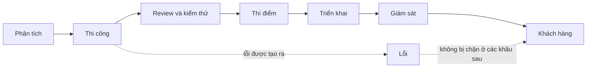

# Bước 2: Xác định vấn đề

## Vì sao cần bước này?

Quy trình phát triển phần mềm thường có nhiều lớp phòng vệ: phân tích, thiết kế, thi công, review, kiểm thử, thí điểm, triển khai, giám sát. Vì vậy **một lỗi đến được tay khách hàng nghĩa là nhiều khâu cùng không chặn được**.

Nếu chỉ xem xét khâu gây ra lỗi, bạn sẽ bỏ sót các lỗ hổng còn lại và sự cố tương tự sẽ quay lại theo đường khác. Hãy đánh giá **tất cả các khâu**.


**Ví dụ:** một sự cố không đăng nhập được sau release có thể gồm 3 vấn đề:

1. Một API mới bị gọi liên tục, làm treo request ở ứng dụng web.
2. Thí điểm trên nhóm khách hàng lớn, lượng truy cập cao, nhưng vẫn không phát hiện lỗi.
3. Thời gian khắc phục lâu (26 phút).


## Luôn xét ít nhất ba nhóm vấn đề

| Nhóm vấn đề | Câu hỏi cốt lõi |
|---|---|
| Lỗi **xảy ra** | Tại sao lỗi được tạo ra ở khâu phân tích, thiết kế, thi công? |
| Lỗi **không được phát hiện** | Tại sao review, kiểm thử, thí điểm, giám sát không bắt được trước khi đến khách hàng? |
| Lỗi **xử lý chậm** | Tại sao mất nhiều thời gian để phát hiện, chẩn đoán, khắc phục? |

## Rà soát từng khâu

Lập bảng và điền cho từng khâu. Nếu một khâu "không có vấn đề", ghi rõ bằng chứng thay vì bỏ qua.

| Khâu | Khâu này đã làm gì để chặn lỗi? | Vì sao không chặn được? | Bằng chứng |
|---|---|---|---|
| Phân tích yêu cầu | | | |
| Thiết kế, thi công | | | |
| Review code | | | |
| Kiểm thử | | | |
| Thí điểm | | | |
| Triển khai | | | |
| Giám sát, cảnh báo | | | |
| Xử lý sự cố | | | |

## Kết quả của bước này

Một danh sách vấn đề ngắn gọn, mỗi vấn đề là một câu khẳng định có bằng chứng. Mỗi vấn đề sẽ trở thành điểm xuất phát cho một chuỗi 5Why ở bước tiếp theo.
