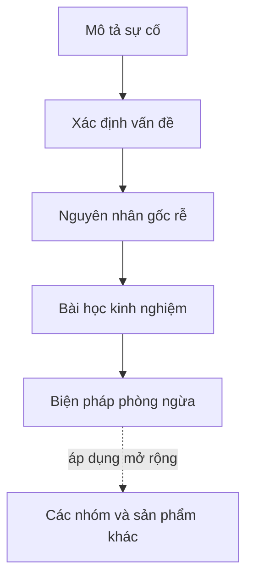

# Vai trò của phân tích sự cố

Mục tiêu của quản lý sự cố là để **sản phẩm, dịch vụ hoạt động ổn định và người dùng có trải nghiệm tốt**. Xử lý nhanh giúp dừng thiệt hại. Phân tích giúp **ngăn thiệt hại lặp lại**.

Phân tích sự cố giúp bạn:

* Hiểu diễn biến thực tế của sự cố.
* Xác định các vấn đề ở từng khâu.
* Chỉ ra nguyên nhân gốc rễ.
* Rút ra bài học và biện pháp phòng ngừa.


Giá trị của một hồ sơ phân tích nằm ở **bài học** và **biện pháp phòng ngừa** có thể áp dụng mở rộng cho các nhóm, sản phẩm khác, chứ không nằm ở việc kể lại sự cố.


## Một hồ sơ gồm những gì?

| Phần | Nội dung | Xem chi tiết |
|---|---|---|
| **Mô tả sự cố** | Trigger và biểu hiện; diễn biến theo thời gian; phạm vi và mức độ ảnh hưởng | [Bước 1](../quy-trinh/mo-ta-su-co.md) |
| **Nguyên nhân gốc rễ** | Phân tích bằng 5Why; phân loại bằng 5M | [Bước 3](../quy-trinh/5why.md), [Bước 4](../quy-trinh/5m.md) |
| **Bài học kinh nghiệm** | Kinh nghiệm phát hiện, xử lý nhanh; kinh nghiệm về phương pháp, kỹ thuật, kỹ năng | [Bước 5](../quy-trinh/bai-hoc.md) |
| **Biện pháp phòng ngừa** | Làm sao để không lặp lại; cập nhật quy trình nào; rà soát hệ thống khác | [Bước 6](../quy-trinh/phong-ngua.md) |

## Khi nào nên viết hồ sơ đầy đủ?

Không phải sự cố nào cũng cần hồ sơ dài. Gợi ý tiêu chí:

| Mức | Dấu hiệu | Mức độ phân tích |
|---|---|---|
| Nghiêm trọng | Ảnh hưởng nhiều khách hàng, mất hoặc sai dữ liệu, gián đoạn kéo dài, ảnh hưởng uy tín | Hồ sơ đầy đủ, họp rút kinh nghiệm |
| Trung bình | Ảnh hưởng một nhóm người dùng, có cách khắc phục tạm | Hồ sơ rút gọn: mô tả, 5Why, phòng ngừa |
| Nhẹ, lặp lại | Ít ảnh hưởng nhưng xảy ra nhiều lần | Gộp nhóm, phân tích theo xu hướng |
